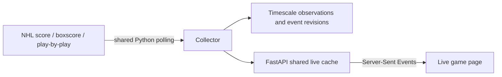

# Daily refresh and saved forecast history

The daily job refreshes NHL sources, then saves one new operational forecast per
UTC day. It preserves the original benchmark files and every earlier forecast.
It does not rerun model selection, tune Elo, use holdout labels for calibration,
or rescan MoneyPuck's shot archive.

## Running and scheduling

From the project root:

```powershell
powershell.exe -NoProfile -ExecutionPolicy Bypass -File scripts/daily-refresh.ps1
```

The wrapper sets Python temp/cache directories to the project's D: drive.
The equivalent command is `.\.venv\Scripts\python.exe -m nhl_analytics.refresh`.
The current NHL season is inferred, with September as the rollover month;
`--season 20262027` is available explicitly. Forecasts cover regular-season
skaters and game wins; this does not add a playoff or goalie projection model.

The installed Windows Task Scheduler task is **NHL Analytics Daily Refresh**,
at **09:30 in the computer's local timezone**. It runs as the signed-in user
with ordinary privileges and does not store a Windows password. Database
credentials remain in the existing ignored `.env`, never in the task arguments.
Docker Desktop and the Timescale container must be running. The computer must
be on and the user signed in. Missed tasks start when available; failures retry
three times at 30-minute intervals. Overlapping tasks are ignored, and a separate
OS-backed file lock also prevents concurrent manual imports. The task has a
two-hour limit and does not start Docker or wake the computer itself.

To change the time or recreate the task:

```powershell
powershell.exe -NoProfile -ExecutionPolicy Bypass -File scripts/install-daily-refresh.ps1 -Time '09:30'
Get-ScheduledTaskInfo -TaskName 'NHL Analytics Daily Refresh'
Start-ScheduledTask -TaskName 'NHL Analytics Daily Refresh'
```

The execution-policy argument applies only to that PowerShell process; it does
not change the machine's policy. Scripts resolve their working directory from
their own location, so Task Scheduler does not depend on a PyCharm terminal.

## What updates

Stages run sequentially to limit memory and API load:

1. Current rosters and all skater/goalie season totals, linked by NHL ID.
2. Current-season league schedules and results, including available playoffs.
3. Current regular-season skater/goalie game logs, with at most two HTTP workers.
4. Team standings and the existing useful team EDGE tracking summaries.
5. Saved display names, roster headshot fallbacks, teams and season membership.
6. New player pace/blended forecasts, frozen residual intervals and improved Elo
   forecasts for games that have not started. Current fixture statuses update;
   completed/in-progress games keep their previously saved pregame forecast.

Existing source importers retain raw responses and deduplicate database rows.
The identity catalog reads small identity tables, not event/shot archives. It
is display metadata and never a training feature. Old seasons and manually
downloaded MoneyPuck CSVs are not downloaded or reimported every day. Updating
those CSVs remains a separate explicit import; advanced historical data is not
misrepresented as current simply because the NHL job ran.

## Dates, history and model provenance

Each new player forecast uses the latest complete game-log and schedule
observations actually recorded **strictly before** its prediction timestamp.
Only observed final games contribute. The previous season supplies player
priors. Each current forecast carries `data_mode: observed_daily`.

The original historical forecasts retain
`data_mode: reconstructed_latest_corrected`. They are not regenerated or
backdated. The serving bundle is labelled
`operational_daily_with_reconstructed_history`, and individual history rows
expose their origin. Strict point-in-time feature/training exports remain in
their existing separate directory and are not replaced by operational archives.

Elo replays frozen historical results plus newly observed current results, using
the already selected K/home-advantage/carryover parameters. Historical rating
replay retains its reconstruction assumptions; daily operation must not be
described as a strict historical backtest. New finals can update today's rating
without waiting for the reconstructed next-noon rule. Interval pools are reused
from the frozen evaluation for the target season, exclude the 2025–26 holdout,
and must predate the forecast. No supported pool means an unavailable interval,
not invented bounds. A new season without frozen calibration requires an
explicitly reviewed calibration update; daily automation does not silently fit it.

Daily archive files are compressed JSON under
`data/predictions/daily/archive/YYYY-MM-DD.json.gz`, with checksum manifests.
They contain player inputs, projections, intervals, known fixtures and that day's
future-game forecasts. Thus prior game probability revisions also remain in the
archives even though the current game endpoint serves the latest saved forecast.
Only one archive is published per UTC day; a successful rerun is a no-op.

Disposable serving SQLite generations combine the unchanged original benchmark
with those daily archives. Archived predictions use insert-only keys; duplicate
timestamps fail rather than overwrite. Only the newest two serving generations
are kept where Windows permits deletion. Raw source snapshots and prediction
archives remain permanent; source-retention policy is a separate decision.
An atomic `latest.json` pointer changes only after a whole new generation has
been built and hashed. A failed stage/publication leaves the last good API bundle
in place. The serving database can be rebuilt from the original benchmark and
archives using `publish_archive` in `nhl_analytics.daily_predictions`.

## API and dashboard

Start the API **without a pinned run**:

```powershell
.\.venv\Scripts\python.exe -m nhl_analytics.api
```

Leave `NHL_PREDICTIONS_RUN` blank. `--run PATH` and a nonblank environment value
intentionally pin a benchmark and disable daily following. `NHL_DAILY_ROOT`
defaults to `data/predictions/daily` and identifies the publication directory.
The API loads the latest daily bundle at startup and checks for a new pointer
every 15 seconds in a background task. Hash verification/indexing never runs in
forecast request handlers. A failed reload retains the previous good bundle.
With no daily publication yet, startup falls back to the newest complete
historical evaluation.

The dashboard checks our saved metadata every minute while visible, loading a
new bundle when its hash changes. Returning to the tab checks again. Game lists
also refresh each minute against the **current** time, so yesterday's already
started games cannot linger in Upcoming even if no new bundle exists. All
times still use the browser's timezone. This does not imply live game scores or
continuous projection recalculation. Daily history graphs show only real saved
points, reduce axis-label density as history grows, and retain exact-value tables.

`GET /api/catalog` serves the saved refreshed display catalog, falling back to
the bundled static catalog before the first refresh. It needs no database
connection per request and works for production builds as well as Vite.

## Failure recovery and checks

`data/refresh/YYYY-MM-DD/manifest.json` records completed stages and publication.
Stage logs are beside it, such as `skater_goalie_logs.log`. Run the same command
again after restoring Docker or connectivity. Completed stages are skipped;
an interrupted game-log stage resumes its saved plan/responses. An interrupted
run can therefore span a data collection window; the forecast timestamp is
chosen after ingestion, not falsely fixed at the beginning of the job.

If debugging sources first, `--ingest-only` finishes ingestion and records
`ingested`; a normal invocation then publishes without importing again.
`--workers 1` reduces concurrent requests. `--no-edge` omits optional EDGE work
for a new run. An already complete UTC day deliberately cannot be force-refreshed
through this command: intraday feeds belong to the separate live workflow below.

```powershell
.\.venv\Scripts\python.exe -m unittest discover -s tests
cd dashboard
npm.cmd test
npm.cmd run build
npm.cmd run test:players
npm.cmd run test:browser
npm.cmd run test:teams
npm.cmd run test:refresh
```

Unit/integration tests cover locks, retry/no-op behavior, actual source cutoffs,
archive preservation, cumulative history, rebuilding, API origin tags and
current-clock game filtering. Browser checks need the API and Vite running.

# Free live-game scope

The next live source should be NHL **GameCenter**, alongside the APIs already
used here. On 11 November 2026, direct unauthenticated requests to the following
returned HTTP 200 for a game listed on that date:

- [Scores and game states for a date](https://api-web.nhle.com/v1/score/2026-11-11)
- [Example game box score](https://api-web.nhle.com/v1/gamecenter/2026020293/boxscore)
- [Example game play-by-play](https://api-web.nhle.com/v1/gamecenter/2026020293/play-by-play)

They supply the building blocks for scores, clock/period, player stat lines and
event timelines; available fields vary before/during/after games. NHL EDGE's
[published tracking views](https://www.nhl.com/nhl-edge/) are useful supplementary
metrics. We have not established a public EDGE event-stream contract or an NHL
webhook subscription, so neither should be assumed as the live transport.

Recommended next implementation:



Start with scores roughly once per minute and box-score/play-by-play polling
every 15–30 seconds **only for active games**, adjusting after measuring provider
latency and errors. Slow down outside game windows, stop hot polling at finals,
recheck final corrections later, honor 429/Retry-After and use bounded retries.
This is a proposed cadence, not a documented NHL rate-limit allowance. Use the
league's calendar date plus the preceding date so UK midnight cannot drop an
ongoing North American game.

One collector serves every viewer; each browser must not independently poll NHL.
SSE provides server-to-browser pushes and reconnect support, so a public inbound
webhook URL is unnecessary. Initial reads return the latest cached state; updates
carry an observed timestamp and stale/disconnected status. Events need stable
`(game_id,event_id)` identity, content hashes and correction/deletion handling;
live stats must not be added repeatedly when the same box score is fetched.
Keep occurrence time separate from actual observation time for future training.
Timescale can retain compressed snapshots/event revisions, with a current view
for fast rendering. Multi-worker fan-out/Redis is unnecessary for the current
single-process local setup; add shared coordination only if the deployment grows.

This requires no paid data account for the tested endpoints and no extra database
product. The existing PC, Python, FastAPI, Timescale and React can handle an initial
version. It is near-live polling, not an exchange-grade guaranteed push feed; the
NHL website endpoints may change or be delayed. It also cannot run while the PC
is off. A future always-on deployment adds hosting considerations, while the
local prototype can remain free of subscription services. The live collector,
SSE endpoints and game pages are now implemented separately from this daily
pipeline. See [live-game setup and retention](LIVE_GAMES.md).
